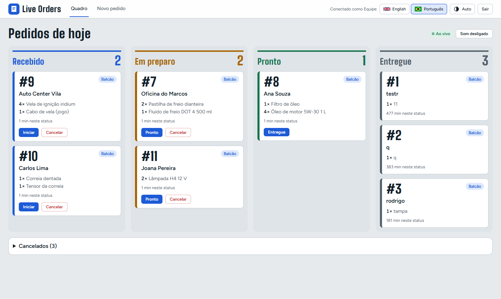
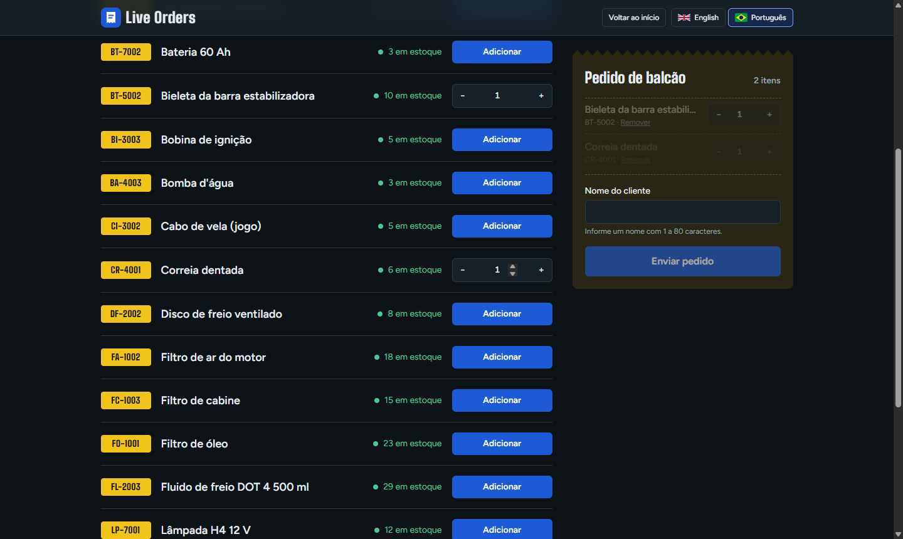
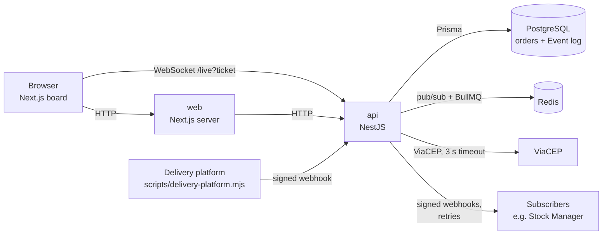

# Live Orders

[](https://github.com/rodrigoZanardo/live-orders/actions/workflows/ci.yml)


**An order board that updates live on every open screen.** The kitchen moves an order and the counter, the dashboard and any connected system see it at the same moment, with no reload.

| Board, light theme | Parts catalog, dark theme |
|---|---|
|  |  |

**Live demo:** https://live-orders-web.onrender.com, sign in with `demo@example.com` / `demo-orders-2026`. The parts catalog for customers is at [/cliente](https://live-orders-web.onrender.com/cliente) and the API docs (Swagger) at https://live-orders-api-c5zu.onrender.com/docs. Free plan: the first visit after a quiet period can take about a minute.

## Run it

You need Docker.

```bash
npm start      # postgres, redis, api and web, built and started
npm run stop
```

| What | URL |
|---|---|
| App | http://localhost:3000 (login `admin@example.com` / `admin-password`) |
| API docs (Swagger) | http://localhost:3001/docs |

## Quick tour

1. Open the board in **two windows** side by side. Create an order on **New order** in one. It appears in both.
2. Click **Start** on one window. The card moves to *Preparing* in the other window within a second.
3. Send orders as the delivery platform would (signed webhook):
   ```bash
   WEBHOOK_INCOMING_SECRET=dev-incoming node scripts/delivery-platform.mjs
   ```
4. Leave an order in *Preparing*. After `LATE_AFTER_MINUTES` (default 10, set it to 1 to see it quickly) it turns red with the word **Late**.
5. Switch to **Português** and between **Auto / Light / Dark** in the menu.
6. On **Webhooks**, register a URL and watch every event arrive, signed (`node scripts/webhook-receiver.mjs`).

## Architecture



The API follows clean architecture layers: `domain` (rules, no framework) → `application` (use cases and ports) → `infra` (Prisma, Redis, BullMQ, ViaCEP) / `http` (controllers, DTOs, Swagger) / `realtime` (WebSocket gateway). Rules for contributors are in [AGENTS.md](AGENTS.md), [api/AGENTS.md](api/AGENTS.md) and [web/AGENTS.md](web/AGENTS.md).

## How real time works

1. **One transaction:** every change writes the `Order` row and its `Event` row together. The `Event` table has a growing `seq` and is both the board's source of truth and the audit trail.
2. **Publish after commit:** only after the transaction commits is the event published to the Redis channel `orders`. A rolled-back change is never announced.
3. **Fan-out:** every API instance subscribes to `orders` and pushes the event to its own WebSocket clients, so the API can run as several copies.
4. **Sign-in for the socket:** the browser never holds the JWT. The board asks its own server for a one-time ticket (`POST /live/ticket`, valid 30 seconds, kept in Redis) and opens the WebSocket with `?ticket=`; the API deletes the ticket on first use.
5. **Catch-up:** the board remembers the last `seq` it applied. On reconnect, or when it sees a gap in `seq`, it calls `GET /events?after=<seq>`. Events are applied in order and duplicates are ignored, so a dropped connection never leaves the board wrong.
6. **Concurrency:** a move carries the `version` the user saw. The database updates only `where id and version` match, so of two people moving the same order at once, exactly one wins. The other gets `409 ORDER_CHANGED`.

## Webhooks and third-party API

- **Incoming:** `POST /webhooks/orders`, HMAC-SHA256 signed, 5-minute replay window, idempotency keys.
- **Outgoing:** every event is sent to registered URLs through a queue, with retries after 1 s, 5 s and 30 s.
- **ViaCEP:** fills the address from a Brazilian CEP, with a 3 s timeout and a fallback.

Details, curl example and payloads: **[docs/WEBHOOKS.md](docs/WEBHOOKS.md)**.

## Technical decisions

| Decision | Why |
|---|---|
| One API service | The point is events and integration. Stock Manager already shows service boundaries |
| Plain `ws` WebSocket | No socket.io protocol to explain; reconnection and catch-up are explicit in the code |
| `Event` table with `seq` | One ordered log feeds the board, the catch-up route, the timeline and the webhooks |
| Redis pub/sub | Every instance gets every event; the board stays correct with more than one API copy |
| BullMQ on the same Redis | Delayed jobs (late alert) and retries (webhooks) without another service |
| Optimistic locking (`version`) | Conflicts are rare, and the database decides them without long-held locks |
| Token passed to the live board | The browser opens the WebSocket itself, so the board receives the session token. The cookie stays `httpOnly` for every other request |

## Tests and CI

- **Unit:** every status move (allowed and refused), item and name rules, HMAC signing and the replay window, the board reducer (ordering and dedupe), translations covering every error code.
- **Integration (real Postgres and Redis):**
  - two concurrent moves, exactly one wins;
  - events are written in the same transaction as the change;
  - parallel requests with the same idempotency key create one order;
  - Redis fan-out reaches two instances;
  - the late job, with a 1 s delay;
  - a webhook receiver that fails twice and then accepts.
- **End to end (Playwright):** two browsers, where one moves an order and the other sees it within 2 s; a webhook order appears on the board; the Portuguese switch.

```bash
npm test                      # unit (+ integration when DATABASE_URL and REDIS_URL are set)
npm run lint && npm run typecheck
npm start && npm run e2e -w @live/web
```

CI runs three jobs on every push: `api` (with Postgres and Redis), `web` (lint, typecheck, tests, build) and `e2e` (the Docker stack and Playwright).

## Next improvements

- Kitchen display mode: full screen, larger cards, sound on by default.
- Per-station views (grill, drinks) by filtering items.
- Re-check the user on WebSocket connect, so a removed user loses the live board before the token expires.
- Daily summary report: orders per hour and average time in each status.
